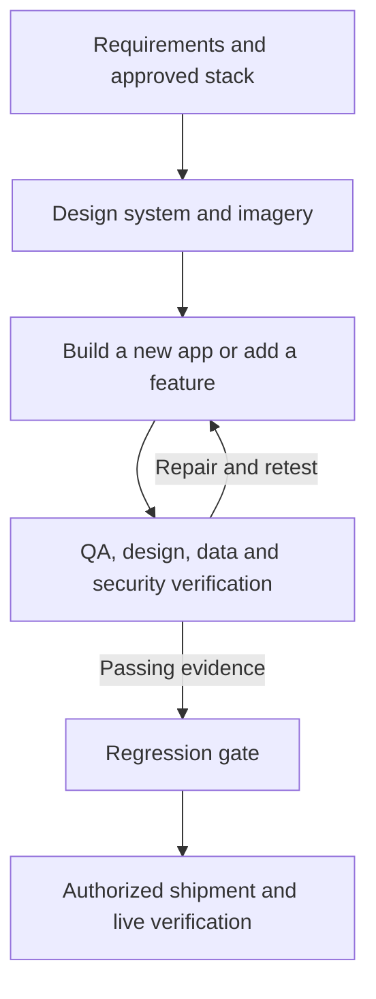

<div align="center">


# AutoForge

**Research the decision. Build the product. Verify every improvement.**

An autonomous iteration engine for Claude Code, OpenCode, OpenAI Codex and Cursor.

[](https://docs.anthropic.com/en/docs/claude-code)
[](https://opencode.ai)
[](https://developers.openai.com/codex)
[](https://cursor.com/docs/skills)

[](LICENSE)

**26 commands · 4 agent platforms · bounded iteration · evidence-backed gates**

[Overview](#overview) · [Features](#features) · [Getting started](#getting-started) · [Usage](#usage) · [Building software](#building-software) · [Software + data](#software--data) · [Safety](#safety) · [Resources](#resources) · [FAQ](#faq)

</div>

## Overview

AutoForge turns a goal into a repeatable **modify → verify → keep/discard** loop. Use it to build
and extend software, improve a measurable result, research a decision, or prepare a release.
`forge` is the command namespace; the work happens inside your existing coding agent and
repository, and every run leaves a history of changes, results and evidence for the next step.

Inspired by [Karpathy's autoresearch](https://github.com/karpathy/autoresearch), it applies
constrained experiments and measurable feedback to software and other domains, and adds the
requirements, design, research, testing and delivery workflows needed to take a project further.

```
LOOP (N iterations or until done):
  1. Review current state + git history + results log
  2. Pick the next change (based on what worked, what failed, what's untried)
  3. Make ONE focused change
  4. Git commit (before verification)
  5. scripts/loop.cjs decide: scope check, Verify (median of N samples), Guard
  6. Improved by at least MinDelta → keep. Anything else → git revert, by the script.
  7. Receipt + TSV row written by the script, never by hand
  8. Repeat until N iterations complete or goal is met.
```

Every improvement stacks. Every failure auto-reverts. A thin skill router loads command bodies
and references only when needed; git history and run artifacts carry the work between iterations
and sessions.

> [!NOTE]
> AutoForge is distributed from a **private repository**, [Jss-on/autoforge](https://github.com/Jss-on/autoforge).
> Authenticate with `gh auth login` or SSH before installing. Release history lives in the
> [project changelog](docs/project-changelog.md).

## Features

| Area | What AutoForge covers | Commands |
|---|---|---|
| Goals and iteration | Natural-language orchestration, explicit metric loops, scope and guard checks, bounded runs, rollback, results analysis | `forge`, `plan`, `evals` |
| Requirements and stack selection | Client review, assumptions, stories, lifecycle scenarios, evidence-based stack comparisons, owner approval, SRS and acceptance specs | `requirements`, `probe` |
| Research and decisions | Primary-source reading, cited claims with confidence, disconfirmation, expert perspectives, blind judging, dossiers and arXiv/IEEE papers | `research`, `predict`, `reason` |
| Product discovery | Customer problems, competitor gaps, ranked improvements, feature PRDs | `improve` |
| Software delivery | Greenfield builds and brownfield features graded on seven acceptance dimensions, with a non-regression ratchet | `build`, `feature` |
| Software + data | A `DATA.md` record for every build, linted and measured against *Designing Data-Intensive Applications* (2nd ed.) | `build`, `feature` |
| Language and framework migration | Frozen inventory, behavior parity, data compatibility, target-only operation, cutover handoff | `migrate` |
| Visual design and assets | Design direction, `DESIGN.md`, purposeful imagery, asset provenance, responsive crops, accessible motion, browser design audits | `design` |
| QA and debugging | Scenario exploration, risk-based plans, traceability, domain-logic vectors, defect ledgers, root-cause repairs, independent retesting | `scenario`, `test`, `debug`, `fix` |
| Stakeholder investigations | Authorized source retrieval, captured observations, explicit uncertainty, plain-language reports | `investigate` |
| Security | STRIDE, OWASP/ASVS-guided checks, authorization and tenant isolation, secrets and dependencies, optional Strix dynamic testing | `security` |
| Stability and release | Baseline/candidate comparison, performance regression checks, release checklists, dry runs, artifact-bound execution evidence, live verification, rollback | `regression`, `ship` |
| Android delivery | PWA preparation, Trusted Web Activity packaging, Digital Asset Links, signed bundles, emulator verification, store materials | `android` |
| Code review and versioning | Merge-request review with validated evidence; semantic-release adoption for existing repositories | `review`, `semver` |
| Contract work in someone else's repository | GitLab and GitHub hosts, issue intake, one merge request per item, their pipeline and reviewers, nothing leaves their host | `backlog` |
| Documentation and memory | Codebase docs, navigable wikis, checked links, run history, procedural lessons retained from verified recoveries | `learn` |

Required checks remain required when a tool or integration is unavailable; the run reports what
is blocked instead of assuming success.

## Getting started

### Prerequisites

| Requirement | Needed for |
|---|---|
| Bash 3.2+ and POSIX tools (Git Bash on Windows) | scripts, hooks, scorers |
| Node.js 18+ (Node 24 in CI) | hooks, verification probes, seams |
| git | the loop itself: commit and revert are the memory |
| Playwright | the build pipeline: headless Chromium for e2e, axe accessibility and `DESIGN.md` conformance. Per project: `npm i -D playwright && npx playwright install --with-deps chromium` |

Optional, per spec: `docker` (devops dimension), `axe` CLI, `k6` or `autocannon` (performance SLOs),
`gh` (GitHub), `glab` (GitLab). Strix needs its CLI, Docker and a configured model provider; Android
packaging needs the toolchain in the [Android guide](guide/forge-android.md); research PDF output
needs LaTeX. Check the environment any time:

```bash
bash scripts/doctor.sh
```

> [!TIP]
> On Windows run the `.sh` tools in **Git Bash**. From PowerShell:
> `& 'C:/Program Files/Git/bin/bash.exe' scripts/doctor.sh`. CI runs the full harness on Linux,
> macOS and Windows.

### Install

**Claude Code** (plugin, recommended):

```
/plugin marketplace add Jss-on/autoforge
/plugin install forge@autoforge
```

Update later with `/plugin marketplace update autoforge`, then `/reload-plugins`.

> [!IMPORTANT]
> Start a new Claude Code session after installing. Reference files are not resolvable in the
> session that installed them.

**OpenCode**, **Cursor** and a local Claude Code copy use the guided installer from a clone:

```bash
git clone https://github.com/Jss-on/autoforge && cd autoforge
./scripts/install.sh --claude --global     # or --opencode / --cursor, --local for one project
```

**Codex** (native plugin):

```powershell
codex plugin marketplace add Jss-on/autoforge
codex plugin add forge@forge-local
```

Open your repository in Codex and start a new thread. Manual copies for every platform, update
paths and the Windows notes are in the [getting started guide](guide/getting-started.md) and the
[Codex guide](guide/forge-codex.md). The nine safety hooks are specific to Claude Code.

### First run

```
/forge
Goal: Increase test coverage from 72% to 90%
Scope: src/**/*.test.ts, src/**/*.ts
Metric: coverage % (higher is better)
Verify: npm test -- --coverage | grep "All files" | awk -F'|' '{print $2}'
Iterations: 25
```

The agent reads every file in scope, establishes a baseline, then iterates one change at a time:
improvements are kept, failures auto-revert, everything is logged. A bare goal also works:
`/forge build me a notes app` routes itself to the right workflow. Don't know the metric? Start
with `/forge:plan`.

## Usage

Commands are workflows entered in the agent's chat, not a standalone executable. All 26 commands
are available on every platform:

| Platform | Core loop / goal | Subcommand example |
|---|---|---|
| Claude Code | `/forge` | `/forge:design` |
| Codex | `$forge` | `$forge design` |
| OpenCode | `/forge` | `/forge_design` |
| Cursor | `/forge` | `/forge design` |

### Commands

| Command | What it does | Default iterations | Guide |
|---|---|---|---|
| `/forge` | Improve a measured result, or route a plain-language goal through the right workflows | 25 / goal-bounded | [forge](guide/forge.md), [orchestrator](guide/forge-orchestrator.md) |
| `/forge:plan` | Convert a goal into a validated Scope / Metric / Verify config | one-shot | [plan](guide/forge-plan.md) |
| `/forge:requirements` | Review assumptions and scenarios, research and approve the stack, validate the SRS and build spec | one-shot | [requirements](guide/forge-requirements.md) |
| `/forge:build` | Build a new app through the SDLC with seven acceptance dimensions and separate logic, data, design and security gates | 40 | [build](guide/forge-build.md) |
| `/forge:feature` | Extend an existing app with delta acceptance and a hard non-regression ratchet | 25 | [feature](guide/forge-feature.md) |
| `/forge:migrate` | Replace a language or framework: scoped inventory, behavioral parity, target-only acceptance, cutover handoff | 25 | [migrate](guide/forge-migrate.md) |
| `/forge:test` | Independent QA: risk-based plan, RTM, execution with evidence, defect ledger, release verdict | 20 | [playbook](guide/building-software-with-forge.md) |
| `/forge:design` | Create `DESIGN.md`, plan imagery, audit a running UI, remediate design and accessibility defects | 12 (`--fix`) | [design](guide/forge-design.md) |
| `/forge:research` | Cited dossier with checked claims; optional arXiv/IEEE paper | 15 | [research](guide/forge-research.md) |
| `/forge:android` | Package a deployed web app as a verified, signed Android TWA with a store pack | 12 | [android](guide/forge-android.md) |
| `/forge:backlog` | Work an employer's or client's backlog on GitLab or GitHub: one item, one branch, one merge request, their pipeline green, their reviewers; never merges its own work | 25 | [backlog](guide/forge-backlog.md) |
| `/forge:review` | Review a merge request in the repository's own format and validate it: `SAFE_TO_MERGE \| NEEDS_CHANGES \| CANNOT_VERIFY`, evidence in a Google Doc; posts only on your word | n/a | [review](guide/forge-review.md) |
| `/forge:semver` | Adopt semantic-release in a repository you own, backfilling what it would have released: `ADOPTED \| PLANNED \| BLOCKED` | n/a | [semver](guide/forge-semver.md) |
| `/forge:debug` | Hunt bugs by hypothesis iteration | 15 | [debug](guide/forge-debug.md) |
| `/forge:investigate` | Investigate a reported issue with captured evidence and explicit uncertainty; `--audit <run>` reviews a case | 12 | [investigate](guide/forge-investigate.md) |
| `/forge:fix` | Remediate defects to zero, root cause first | 20 | [fix](guide/forge-fix.md) |
| `/forge:security` | Audit security boundaries, optionally run Strix, gate readiness on checks and unresolved findings | 15 | [security](guide/forge-security.md) |
| `/forge:ship` | Check, preview, authorize, execute and verify a shipment; handle rollback | linear | [ship](guide/forge-ship.md) |
| `/forge:scenario` | Generate edge cases across 12 dimensions | 20 | [scenario](guide/forge-scenario.md) |
| `/forge:predict` | Five expert personas debate the code | one-shot | [predict](guide/forge-predict.md) |
| `/forge:learn` | Create, update, check or summarize documentation; build a codebase wiki | 10 | [learn](guide/forge-learn.md) |
| `/forge:reason` | Adversarial refinement with blind judges | 8 | [reason](guide/forge-reason.md) |
| `/forge:probe` | Interrogate assumptions and constraints with adversarial personas | 15 | [probe](guide/forge-probe.md) |
| `/forge:improve` | Research the ICP, discover improvements, generate PRDs | 15 | [improve](guide/forge-improve.md) |
| `/forge:evals` | Analyze iteration results: trends, plateaus, recommendation | one-shot | [evals](guide/forge-evals.md) |
| `/forge:regression` | Stability gate: baseline versus candidate, `STABLE` / `UNSTABLE` | one-shot | [regression](guide/forge-regression.md) |

**Universal flags:** `Iterations: N`, `Iterations: unlimited`, `Guard: <command>`, `--evals`,
`--evals-interval N`, `--chain <targets>`, `--<subcommand>` shorthand.

### Which command?

| I want to... | Use |
|---|---|
| Turn a client brief into a validated build spec, stack approved on evidence | `/forge:requirements Brief: "..."` |
| Build a new full-stack app from scratch | `/forge:build Spec: evals/fullstack/<name>.spec.yaml` |
| Add a feature without regressions | `/forge:feature Feature: "..." Target: <app>` |
| Run QA, then remediate the ledger, unattended | `/forge:test Target: <app> --chain fix` |
| Give the interface a direction, then audit and fix it | `/forge:design system` → `/forge:design audit --fix` |
| Audit security, optionally with dynamic testing | `/forge:security [--strix --strix-budget <USD>]` |
| Gate a release, then ship with authorization | `/forge:regression --chain ship` |
| Improve any metric without breaking tests | `/forge` with `Guard: npm test` |
| Work one ticket in someone else's GitLab or GitHub repo | `/forge:backlog Item: <id>` |
| Prove a merge request is safe to merge | `/forge:review <number>` |
| Version a repository's whole history as semantic-release would have | `/forge:semver Target: <owner/repo>` |
| Ship a built web app to Android | `/forge:android` |
| Research a topic into a cited dossier | `/forge:research` |
| Document a codebase, or build its wiki | `/forge:learn --mode init` / `--mode wiki` |

More recipes: [examples by domain](guide/examples-by-domain.md),
[chains and combinations](guide/chains-and-combinations.md), [advanced patterns](guide/advanced-patterns.md).

## Building software

The build, design, QA and delivery workflows form a software-development-lifecycle engine: the
forge loop applied to a growing acceptance set. The full playbook is
[Building Software with AutoForge](guide/building-software-with-forge.md).



Every app is graded by one mechanical metric, `fullstack_pass_rate` (`scripts/score-build.sh`), a
weighted sum over seven dimensions whose weights are renormalized over the dimensions present:

| Dimension | Weight | What must hold |
|---|---|---|
| **logic** | 0.30 | domain rules compute correctly: golden vectors from the SRS (gating) |
| functional | 0.30 | CRUD, endpoints, tests, coverage ≥ 80 % |
| **ux** | 0.20 | responsive, WCAG AA (axe), e2e flows, loading/empty/error states, `DESIGN.md` conformance |
| devops | 0.15 | container build, CI (lint, test, build, scan), compose or IaC, migrations |
| monitoring | 0.15 | health and readiness, request-duration histogram, replication or consumer lag, freshness, structured logs, tracing |
| hardening | 0.20 | no secrets, security headers, input validation, rate limits, authorization, dependency scan |
| **data** | 0.20 | the data architecture holds: `DATA.md` linted and measured (gating, see [Software + data](#software--data)) |

`logic` and `data` are **gating**: while any of their rows is red the headline is capped at 0.50.
Acceptance is verified by running the app (build, boot, probes, the test pyramid, Playwright e2e
and axe), never self-reported, and every receipt is bound to the commit it measured.

```
# 1. Review assumptions and stories, approve the stack, validate the spec
/forge:requirements Brief: "personal money tracker, offline"

# 2. Build to passing acceptance
/forge:build Spec: evals/fullstack/money-tracker.spec.yaml Iterations: 40

# 3. Add a feature later, under the non-regression ratchet
/forge:feature Feature: "recurring transactions" Target: build-output/money-tracker

# 4. Independent QA, then remediation, then re-engagement
/forge:test Target: build-output/money-tracker --chain fix

# 5. Gate, then ship (human-gated)
/forge:regression --chain ship
```

- **Requirements** shows what it understood, every assumption, and draft stories with scenarios in
  plain words; you correct a living review until nothing is agreed through silence. The stack is
  chosen the same way: 3–5 candidates compared on evidence, your approval or mandate recorded, and
  the choice confirmed by a measured spike before build starts.
- **Build** runs plan, feasibility, requirements, design, implement (TDD), debug, test, deploy and
  operate as one loop: one atomic slice per iteration, committed before verification, kept only if
  the pass rate rises and the guard stays green. Security is a separate completion gate that a lower
  target cannot waive.
- **Feature** appends only the delta acceptance and auto-reverts any existing green that turns red.
- **Test** never fixes what it finds; **fix** never grades its own work. That independence is what
  makes the `RELEASE_RECOMMENDED | RELEASE_BLOCKED` verdict worth something.
- **Design** produces a machine-readable `DESIGN.md` through a mode-aware direction protocol, and a
  craft floor (`SLOP_GATE`) rejects emoji icons, nested cards, purple gradients, placeholder names,
  low-contrast text and the other attractors; `/forge:design audit` ends with `SHIP | FIX | REBUILD`.
- **Large systems** decompose into one spec per service: build the core, grow by features under the
  ratchet, gate every increment with `regression`, ship when green.

## Software + data

Software that can lose, corrupt or leak data is never "done". Every build and feature carries a
`DATA.md` record in eight groups, workload, SLO, model, integrity, evolution, durability, derived
data and retention, written against the
[data-intensive protocol](.claude/skills/forge/references/data-intensive-protocol.md), which encodes
Kleppmann & Riccomini's *Designing Data-Intensive Applications* (2nd ed.) section by section: a
[book map](.claude/skills/forge/references/data-intensive-book-map.md), a
[section ledger](.claude/skills/forge/references/data-intensive-section-ledger.md) of all 216
sections with the mechanism and the forge artifact each became, chapter digests, and a
[metrics research ledger](.claude/skills/forge/references/data-intensive-metrics-research.md) whose
every quotation is verified against the fetched source.

The `data` dimension measures rather than trusts: response-time percentiles under an **open**
arrival-rate load, hot paths indexed, no lost update under concurrency, idempotent retries, durable
acknowledgements that survive `SIGKILL`, expand/contract migrations, a timed restore drill, derived
data reconciled against its system of record, and erasure that reaches every copy. The lint refuses
a record that has not decided its trust model, fault model, replication log type and whether every
derived job re-runs idempotently.

## Safety

### Eight rules

| # | Rule |
|---|---|
| 1 | **Bounded by default**: every command has a default iteration count; unlimited is opt-in |
| 2 | **Read before write**: understand the full context before modifying |
| 3 | **One change per iteration**: atomic changes, so a break explains itself |
| 4 | **Mechanical verification only**: `scripts/loop.cjs` measures, decides, reverts and logs; the model never computes a metric by hand |
| 5 | **Automatic rollback**: any status other than keep reverts the whole experiment range |
| 6 | **Simplicity wins**: equal results inside the noise floor with less code is `keep (simpler)` |
| 7 | **Git is memory**: experiments are committed with an `experiment:` prefix under your own git identity, never a model's |
| 8 | **When stuck, think harder**: re-read, combine near-misses, try radical changes |

### Guard

`Verify` asks "did the metric improve?"; `Guard` asks "did anything else break?". When the metric
improves but the guard fails, the loop reworks the change (up to two attempts) and never edits the
guard's test files.

```
/forge
Goal: Reduce API response time to under 100ms
Verify: npm run bench:api | grep "p95" | awk '{print $NF}' | tr -d 'ms'
Guard: npm test
```

### Hooks

Nine hooks protect every Claude Code session, not only forge runs. All are on by default; disable
one with `AR_DISABLE_<HOOK_NAME>=1`, customize blocked paths with a `.ckignore` file, and send a
completion webhook with `AR_NOTIFY_WEBHOOK`. Full reference: [guide/hooks.md](guide/hooks.md).

| Hook | What it does |
|---|---|
| scout-block | Keeps `node_modules/`, `.git/`, `__pycache__/` and similar out of the context |
| privacy-block | Blocks reads of `.env`, SSH keys and credentials |
| dangerous-cmd-block | Blocks force-push, `rm -rf`, `git reset --hard`, and any commit or merge request naming a model as author |
| iteration-context, dev-rules-reminder, subagent-context | Re-inject loop state, plan path and code standards after compaction and into subagents |
| simplify-gate | Suggests simplifying when you ship with 400+ uncommitted changed lines; never blocks |
| session-init, stop-notify | Project context at start; terminal notification and optional webhook at the end |

### Results and recovery

Every iteration is a TSV row, and `/forge:evals` reads any results file for trends and plateaus:

```tsv
iteration  commit   metric  delta   status    description
0          a1b2c3d  85.2    0.0     baseline  initial state
1          b2c3d4e  87.1    +1.9    keep      add tests for auth edge cases
2          -        86.5    -0.6    discard   refactor test helpers (broke 2 tests)
```

Syntax errors are fixed without counting an iteration; runtime errors get three attempts; resource
exhaustion reverts to a smaller variant; hangs are killed and reverted; an unavailable dependency is
logged and skipped. Run state travels in a validated `handoff.json`, and logs and evidence live under
`forge/<command>-<timestamp>/` in the target repository.

## Resources

- [Guides](guide/README.md): one per command, plus [getting started](guide/getting-started.md) and the [build playbook](guide/building-software-with-forge.md)
- [Integrations and assets](.claude/skills/forge/references/integrations-protocol.md): image generation and reuse, Figma import, GitHub/GitLab/Linear tracking, Strix, procedural memory
- [Host protocol](.claude/skills/forge/references/host-protocol.md): GitHub and GitLab detection, owner versus contributor rules
- [Agent contract](AGENTS.md), [comparison with autoresearch](COMPARISON.md), [project changelog](docs/project-changelog.md)
- [Contributing](CONTRIBUTING.md): development setup, the multi-platform transform, adding a command, publishing and releasing AutoForge itself

### Repository structure

```
autoforge/
├── README.md · AGENTS.md · COMPARISON.md · CONTRIBUTING.md · LICENSE · NOTICE
├── guide/                      ← one guide per command + the build playbook
├── docs/                       ← design and release documentation; assets/ holds the logo
├── evals/fullstack/            ← build specs (*.spec.yaml)
├── tests/                      ← harness self-tests (parity, hooks, scorers, book verifiers)
├── scripts/                    ← installer, doctor, transform, scorers, seams, release tooling
├── .claude/
│   ├── skills/forge/           ← SKILL.md routing table + references/ (the protocols)
│   └── commands/forge/         ← 25 subcommand files (26 commands total)
├── .claude-plugin/             ← marketplace manifest (marketplace name: autoforge)
├── claude-plugin/              ← Claude Code plugin package (skills + commands + hooks)
├── .opencode/ · .agents/ · .cursor/   ← OpenCode, Codex and Cursor ports (via scripts/transform.sh)
└── plugins/forge/              ← Codex plugin package
```

## FAQ

**I don't know what metric to use.** Run `/forge:plan`: it analyzes the codebase, suggests
metrics and dry-runs the verify command.

**How do I build a whole app rather than optimize one metric?** `requirements` → `build` →
`feature` → `test --chain fix` → `regression` → `ship`. See [Building software](#building-software).

**Will Forge choose a technology stack without me?** No. Requirements compares real options with
evidence and records your approval or mandate; build confirms the choice with a measured spike.

**Does a passing security audit mean the app is secure?** It means the planned checks passed for
the recorded candidate and environment with no unresolved findings at the chosen threshold. Strix
adds dynamic evidence; production configuration and future changes need their own verification.

**Does `/forge:security` modify my code?** The audit keeps application source read-only. Strix
scans use disposable copies. `--fix` remediates confirmed Critical/High findings on request.

**How do I stop a loop?** `Ctrl+C`, or set `Iterations: N`. The loop commits before verifying, so
the last good state is always in git.

**Can I use this for non-code work?** Yes: anything with a measurable metric. See
[examples by domain](guide/examples-by-domain.md).

**Predict or reason?** `predict` is a one-shot debate over existing code; `reason` is an iterative
refinement with blind judges for decisions that have no objective metric.

**What is `handoff.json`?** The validated file that carries Goal / Scope / Metric / Verify and a
run's status between chained commands.

---

<div align="center">

Built on the [autoresearch](https://github.com/uditgoenka/autoresearch) engine by Udit Goenka (MIT, see [NOTICE](NOTICE)), after [Andrej Karpathy's autoresearch](https://github.com/karpathy/autoresearch). Runs on [Claude Code](https://docs.anthropic.com/en/docs/claude-code), [OpenCode](https://opencode.ai), [Codex](https://developers.openai.com/codex) and [Cursor](https://cursor.com/docs/skills).

</div>
